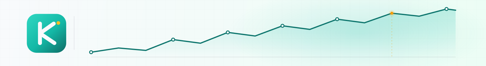

<div align="center">

<picture>
  <source media="(prefers-color-scheme: dark)" srcset="docs/assets/banner-dark.svg" />
  
</picture>

# Kurumi

**Financial analytics for Rust · decimal money · streaming indicators**

[](LICENSE)
[](https://github.com/oxroot-crypto/kurumi/actions/workflows/ci.yml)
[](Cargo.toml)

</div>

---

English | [简体中文](README.zh-CN.md)

- [Features](#features)
- [Workspace](#workspace)
- [Installation](#installation)
- [Quick Start](#quick-start)
- [Usage](#usage)
- [Configuration](#configuration)
- [Development](#development)
- [Contributing](#contributing)
- [License](#license)

Kurumi is a financial library for Rust (Edition 2024), organized as a ten-crate Cargo workspace. It keeps cash and order accounting in `rust_decimal::Decimal`, validates model inputs at public boundaries, and makes backtests and paper trading reproducible from market events.

## Features

- **Exact decimal accounting** — `Decimal` for cash, quantities, and fills; `f64` for models and statistics.
- **One-way crate layering** — ten crates with acyclic dependencies; use the facade or any layer alone.
- **Streaming indicators** — O(1) updates, batch parity for SMA, EMA, RSI, MACD, ATR, Bollinger.
- **Pricing engines** — Black-Scholes-Merton, CRR binomial, implied volatility, yield curves, and bonds.
- **Risk and portfolio analytics** — VaR, CVaR, drawdowns, optimizers, risk decomposition, and rebalancing.
- **Deterministic backtests** — single- and multi-asset engines, walk-forward analysis, and a parallel grid search.
- **Execution and live data** — Sans-I/O paper matching plus async Nasdaq ITCH/NCDS and WebSocket connectors.

## Workspace

Each layer has one responsibility, and dependencies point in one direction only.

| Crate | Responsibility |
| --- | --- |
| `kurumi-core` | Money, decimals, calendars, day-count conventions, ring buffers, and `KurumiError`. |
| `kurumi-math` | Interpolation, root finding, random number generation, statistics, covariance and correlation, regression, and linear algebra. |
| `kurumi-ta` | OHLCV bars, O(1) streaming indicators, and vectorized batch indicators. |
| `kurumi-pricing` | Yield curves, cashflows, fixed-rate bonds, Black-Scholes-Merton, CRR binomial, and implied volatility. |
| `kurumi-risk` | VaR, CVaR, performance and drawdown metrics, position sizing, and benchmark-relative metrics. |
| `kurumi-portfolio` | `(T, N)` return panels, optimizers, risk decomposition, rebalancing, and rolling beta/correlation. |
| `kurumi-backtest` | Single- and multi-asset simulation, fee and slippage models, walk-forward analysis, and grid search. |
| `kurumi-exec` | Order state machine, reservation ledger, pre-trade risk gates, paper matching, audit journal, and runners; optional live brokers. |
| `kurumi-feed` | Async Nasdaq ITCH/NCDS and Alpaca-compatible WebSocket connectors, reconnection, a fan-out hub, and bar aggregation. |
| `kurumi` | Feature-gated facade, prelude, and the planned Python/WASM binding surface. |

```text
kurumi-core < kurumi-math < kurumi-ta / kurumi-pricing < kurumi-risk
            < kurumi-portfolio < kurumi-backtest < kurumi-exec < kurumi

kurumi-core < kurumi-ta < kurumi-feed
kurumi-exec --(live feature)--> kurumi-feed
```

`kurumi-feed` is an isolated asynchronous branch, reached only through the `feed`/`exec-live` facade features and the `kurumi-exec` `live` feature. `kurumi-exec` is Sans-I/O by default. Python and WebAssembly bindings are planned as opt-in facade features and are not implemented in this revision.

## Installation

### Prerequisites

| Requirement | Minimum | Notes |
| --- | --- | --- |
| Rust | 1.85 | Edition 2024; `rust-version = "1.85"` in `Cargo.toml`. |
| Cargo | Bundled with Rust | Uses workspace resolver 3. |
| Git | — | Fetches the Git dependency or clones the source. |

### Add the dependency

The facade in this repository is not published on crates.io. Use a Git dependency:

```toml
[dependencies]
kurumi = { git = "https://github.com/oxroot-crypto/kurumi", branch = "main" }
# Exact amounts for orders, fills, and ledgers.
rust_decimal = "1"
```

`rust_decimal` is only needed when you construct `Decimal` amounts directly for cashflows, orders, or ledgers. For a runtime-free synchronous build, disable the defaults and enable only the layer you need:

```toml
[dependencies]
kurumi = { git = "https://github.com/oxroot-crypto/kurumi", branch = "main", default-features = false, features = ["risk"] }
```

## Quick Start

### 1. Create a crate

```sh
cargo new kurumi-demo
cd kurumi-demo
```

### 2. Add Kurumi

Replace `Cargo.toml` with:

```toml
[package]
name = "kurumi-demo"
version = "0.1.0"
edition = "2024"

[dependencies]
kurumi = { git = "https://github.com/oxroot-crypto/kurumi", branch = "main" }
```

### 3. Run the example

Replace `src/main.rs` with:

```rust
use kurumi::prelude::*;

fn main() -> Result<(), Box<dyn std::error::Error>> {
    // Streaming SMA: O(1) per update, no allocation after construction.
    let mut sma = Sma::new(3)?;
    let closes = [100.0, 101.0, 102.0, 103.0];
    let averages = closes
        .iter()
        .map(|close| sma.next(*close))
        .collect::<Result<Vec<_>, _>>()?;
    println!("SMA(3): {averages:?}");

    // Risk metrics from four periodic simple returns.
    let returns = [0.01, -0.02, 0.015, 0.005];
    let metrics = PerformanceMetrics::from_returns(&returns, MetricsConfig::default())?;
    println!(
        "observations={} annualized_volatility={:.6}",
        metrics.observations, metrics.annualized_volatility
    );

    Ok(())
}
```

Then run:

```sh
cargo run
```

Expected output:

```text
SMA(3): [None, None, Some(101.0), Some(102.0)]
observations=4 annualized_volatility=0.246779
```

## Usage

Each example is a complete `src/main.rs` for the crate created in Quick Start. The same examples live in [`crates/kurumi/examples/`](crates/kurumi/examples/) and can be run with `cargo run -p kurumi --example quickstart`. The backtest example also needs `rust_decimal = "1"`, as shown in Installation.

### Price a European option

A one-year at-the-money call: spot 100, strike 100, risk-free rate 5%, no dividend yield, 20% volatility.

```rust
use kurumi::prelude::*;

fn main() -> Result<(), Box<dyn std::error::Error>> {
    let market = MarketData::new(100.0, 0.05, 0.0, 0.20)?;
    let engine = BlackScholesMertonEngine::new(market);
    let call = OptionContract::new(
        OptionType::Call,
        100.0,
        Date::from_ymd(2025, 1, 1)?,
        ExerciseStyle::European,
    )?;

    let value = engine.price(&call, Date::from_ymd(2024, 1, 1)?)?;
    println!("npv={:.4}", value.npv);

    if let Some(greeks) = value.greeks {
        println!("delta={:.4} vega={:.4}", greeks.delta, greeks.vega);
    }

    Ok(())
}
```

Expected output:

```text
npv=10.4681
delta=0.6370 vega=37.5691
```

### Measure portfolio risk

Align two price series on their common timestamps, build a `(T, N)` return matrix, and decompose 60/40 portfolio risk.

```rust
use kurumi::portfolio::chrono::{DateTime, Utc};
use kurumi::portfolio::nalgebra::DVector;
use kurumi::prelude::*;

fn at(day: i64) -> DateTime<Utc> {
    DateTime::from_timestamp(day * 86_400, 0).unwrap_or_default()
}

fn main() -> Result<(), Box<dyn std::error::Error>> {
    let a = AssetSeries::new(
        "A",
        vec![
            (at(0), 100.0),
            (at(1), 102.0),
            (at(2), 101.0),
            (at(3), 105.0),
            (at(4), 107.0),
            (at(5), 110.0),
        ],
    )?;
    let b = AssetSeries::new(
        "B",
        vec![
            (at(0), 50.0),
            (at(1), 49.5),
            (at(2), 50.5),
            (at(3), 51.0),
            (at(4), 52.0),
            (at(5), 53.0),
        ],
    )?;

    // Align both series on their common timestamps and build a (T, N) matrix.
    let returns = ReturnMatrix::from_price_series(
        &[a, b],
        AlignmentPolicy::InnerJoin,
        ReturnMethod::Simple,
    )?;
    let covariance = returns.covariance_matrix()?;

    let weights = PortfolioWeights::new(
        vec!["A".to_owned(), "B".to_owned()],
        DVector::from_vec(vec![0.6, 0.4]),
    )?;
    let risk = risk_decomposition(&weights, &covariance)?;

    println!("portfolio_volatility={:.6}", risk.portfolio_volatility);
    println!("pctr_A={:.4} pctr_B={:.4}", risk.pctr[0], risk.pctr[1]);

    Ok(())
}
```

Expected output:

```text
portfolio_volatility=0.010892
pctr_A=0.8946 pctr_B=0.1054
```

### Run a backtest

Start with 100,000 USD, buy 100 shares, and apply a 5 bps fee and 2 bps slippage over three bars.

```rust
use kurumi::prelude::*;
use rust_decimal::Decimal;

fn main() -> Result<(), Box<dyn std::error::Error>> {
    let mut engine = BacktestEngine::with_cash(
        Decimal::from(100_000),
        Currency::Usd,
        Box::new(FixedRateFee::new(Decimal::new(5, 4))?),
        Box::new(FixedBpsSlippage::new(Decimal::from(2))?),
    )?;

    engine.submit(Order::market(
        Side::Buy,
        Quantity::new(Decimal::from(100))?,
    ))?;

    for (index, price) in [100.0, 102.0, 104.0].iter().enumerate() {
        let bar = OhlcvBar::new(
            index as i64,
            *price,
            price + 1.0,
            price - 1.0,
            *price,
            1_000.0,
            price * 1_000.0,
        )?;
        engine.on_bar(&bar)?;
    }

    let report = engine.report(MetricsConfig::default())?;
    println!(
        "fills={} final_equity={}",
        report.fill_count, report.final_equity
    );

    Ok(())
}
```

Expected output:

```text
fills=1 final_equity=100392.99900000
```

## Configuration

The facade is configured with additive Cargo features. The default feature set is `full` plus `parallel`; `--no-default-features` removes every module.

| Feature | Type | Default | Description |
| --- | --- | --- | --- |
| `core` | Cargo feature | Via `full` | Money, dates, calendars, and the shared error type. |
| `math` | Cargo feature | Via `full` | Adds `core`. Numerics, statistics, regression, and linear algebra. |
| `ta` | Cargo feature | Via `full` | Adds `math`. OHLCV bars and technical indicators. |
| `pricing` | Cargo feature | Via `full` | Adds `math`. Curves, bonds, and option engines. |
| `risk` | Cargo feature | Via `full` | Adds `ta` and `pricing`. Risk and performance metrics. |
| `portfolio` | Cargo feature | Via `full` | Adds `risk`. Panels, optimizers, and risk decomposition. |
| `backtest` | Cargo feature | Via `full` | Adds `portfolio`. Single- and multi-asset backtests. |
| `exec` | Cargo feature | Via `full` | Adds `backtest`. Sans-I/O execution kernel. |
| `exec-live` | Cargo feature | Via `full` | Adds `exec`, `feed`, and `kurumi-exec/live`. Async brokers and `LiveRunner`. |
| `feed` | Cargo feature | Via `full` | Adds `ta`. Async market-data runtime and connectors. |
| `parallel` | Cargo feature | Yes | Adds `backtest` and enables Rayon grid search, also in `kurumi-exec` when present. |
| `full` | Cargo feature | Yes | Enables every module feature. |

`cargo check -p kurumi --no-default-features` builds the facade with no modules enabled. `cargo check -p kurumi --all-features` verifies the complete graph.

## Development

```sh
git clone https://github.com/oxroot-crypto/kurumi.git
cd kurumi

cargo build --workspace
cargo fmt --all -- --check
cargo clippy --workspace --all-targets --locked -- -D warnings
cargo test --workspace --all-features --locked
cargo doc --workspace --no-deps --locked
cargo check -p kurumi --no-default-features --locked
cargo check -p kurumi --all-features --locked
cargo build -p kurumi --examples --all-features --locked
cargo run -p kurumi --example quickstart
cargo run -p kurumi --example option_pricing
cargo run -p kurumi --example portfolio_risk
cargo run -p kurumi --example backtest
```

CI treats rustdoc warnings as errors and checks the Rust 1.85 MSRV. The test suite runs offline; live endpoint tests are ignored and read credentials from environment variables.

## Contributing

Contributions are welcome. Read [CONTRIBUTING.md](CONTRIBUTING.md) for setup, checks, and code standards, and [AGENTS.md](AGENTS.md) for the architecture invariants. All participants are expected to follow the [Code of Conduct](CODE_OF_CONDUCT.md).

Run the Development checks before opening a pull request, add Rustdoc and tests for every new public API, and record user-visible changes in [CHANGELOG.md](CHANGELOG.md). Report security issues through [SECURITY.md](SECURITY.md).

## License

Released into the public domain under the [Unlicense](LICENSE).
