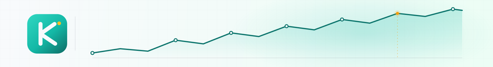

<div align="center">

<picture>
  <source media="(prefers-color-scheme: dark)" srcset="docs/assets/banner-dark.svg" />
  
</picture>

# Kurumi

**Financial analytics for Rust · decimal money · streaming indicators**

[](LICENSE)
[](https://github.com/oxroot-crypto/kurumi/actions/workflows/ci.yml)
[](Cargo.toml)

</div>

---

[English](README.md) | 简体中文

- [功能特性](#功能特性)
- [工作区](#工作区)
- [安装](#安装)
- [快速开始](#快速开始)
- [用法](#用法)
- [配置](#配置)
- [开发](#开发)
- [贡献](#贡献)
- [许可证](#许可证)

Kurumi 是一个 Rust（Edition 2024）金融库，由十个 crate 组成一个 Cargo workspace。现金与订单记账使用 `rust_decimal::Decimal`，公开边界会校验模型输入，回测与模拟交易可由市场事件完整复现。

## 功能特性

- **精确的十进制记账** — 现金、数量与成交使用 `Decimal`，连续模型与统计量使用 `f64`。
- **单向 crate 分层** — 十个 crate 依赖关系无环；可通过门面整体使用，也可单独依赖任一层。
- **流式技术指标** — SMA、EMA、RSI、MACD、ATR、Bollinger 均为 O(1) 更新，且与批量结果一致。
- **定价引擎** — Black-Scholes-Merton、CRR 二叉树、隐含波动率、收益率曲线与债券。
- **风险与组合分析** — VaR、CVaR、回撤、优化器、风险分解与再平衡。
- **确定性回测** — 单资产与多资产引擎、walk-forward 分析、并行参数网格搜索。
- **执行与实时行情** — Sans-I/O 模拟撮合，以及异步 Nasdaq ITCH/NCDS 与 WebSocket 连接器。

## 工作区

每一层只负责一件事，依赖只朝一个方向流动。

| Crate | 职责 |
| --- | --- |
| `kurumi-core` | 货币、十进制数值、日历、日计数惯例、环形缓冲区与 `KurumiError`。 |
| `kurumi-math` | 插值、求根、随机数生成、统计、协方差与相关性、回归和线性代数。 |
| `kurumi-ta` | OHLCV K 线、O(1) 流式指标与向量化批量指标。 |
| `kurumi-pricing` | 收益率曲线、现金流、固定利率债券、Black-Scholes-Merton、CRR 二叉树与隐含波动率。 |
| `kurumi-risk` | VaR、CVaR、绩效与回撤指标、仓位管理、基准相对指标。 |
| `kurumi-portfolio` | `(T, N)` 收益面板、优化器、风险分解、再平衡，以及滚动 beta/相关性。 |
| `kurumi-backtest` | 单资产与多资产模拟、手续费与滑点模型、walk-forward 分析与网格搜索。 |
| `kurumi-exec` | 订单状态机、预留账本、预交易风控、模拟撮合、审计日志与运行器；可选实盘券商。 |
| `kurumi-feed` | 异步 Nasdaq ITCH/NCDS 与兼容 Alpaca 的 WebSocket 连接器、重连、扇出中心与 K 线聚合。 |
| `kurumi` | 由 Cargo feature 控制启用的门面（facade）、prelude，以及规划中的 Python/WASM 绑定层。 |

```text
kurumi-core < kurumi-math < kurumi-ta / kurumi-pricing < kurumi-risk
            < kurumi-portfolio < kurumi-backtest < kurumi-exec < kurumi

kurumi-core < kurumi-ta < kurumi-feed
kurumi-exec --(live feature)--> kurumi-feed
```

`kurumi-feed` 是隔离的异步分支，仅通过门面的 `feed`/`exec-live` feature 与 `kurumi-exec` 的 `live` feature 接入。`kurumi-exec` 默认遵循 Sans-I/O。Python 与 WebAssembly 绑定计划作为门面的可选 feature，本版本尚未实现。

## 安装

### 环境要求

| 依赖 | 最低版本 | 说明 |
| --- | --- | --- |
| Rust | 1.85 | 使用 Edition 2024；`Cargo.toml` 中声明 `rust-version = "1.85"`。 |
| Cargo | 随 Rust 提供 | 使用 workspace resolver 3。 |
| Git | — | 用于拉取 Git 依赖或克隆源码。 |

### 添加依赖

本仓库中的 `kurumi` 门面尚未发布到 crates.io。请使用 Git 依赖：

```toml
[dependencies]
kurumi = { git = "https://github.com/oxroot-crypto/kurumi", branch = "main" }
# 订单、成交与账本使用的精确金额。
rust_decimal = "1"
```

`rust_decimal` 仅在使用 `Decimal` 直接构造现金流、订单或账本金额时需要。若要保持无异步运行时的同步构建，请关闭默认特性，只启用需要的层：

```toml
[dependencies]
kurumi = { git = "https://github.com/oxroot-crypto/kurumi", branch = "main", default-features = false, features = ["risk"] }
```

## 快速开始

### 1. 创建 crate

```sh
cargo new kurumi-demo
cd kurumi-demo
```

### 2. 添加 Kurumi

将 `Cargo.toml` 替换为：

```toml
[package]
name = "kurumi-demo"
version = "0.1.0"
edition = "2024"

[dependencies]
kurumi = { git = "https://github.com/oxroot-crypto/kurumi", branch = "main" }
```

### 3. 运行示例

将 `src/main.rs` 替换为：

```rust
use kurumi::prelude::*;

fn main() -> Result<(), Box<dyn std::error::Error>> {
    // 流式 SMA：每次更新 O(1)，构造后不再分配内存。
    let mut sma = Sma::new(3)?;
    let closes = [100.0, 101.0, 102.0, 103.0];
    let averages = closes
        .iter()
        .map(|close| sma.next(*close))
        .collect::<Result<Vec<_>, _>>()?;
    println!("SMA(3): {averages:?}");

    // 由四个周期的简单收益率计算风险指标。
    let returns = [0.01, -0.02, 0.015, 0.005];
    let metrics = PerformanceMetrics::from_returns(&returns, MetricsConfig::default())?;
    println!(
        "observations={} annualized_volatility={:.6}",
        metrics.observations, metrics.annualized_volatility
    );

    Ok(())
}
```

然后运行：

```sh
cargo run
```

预期输出：

```text
SMA(3): [None, None, Some(101.0), Some(102.0)]
observations=4 annualized_volatility=0.246779
```

## 用法

每个示例都是快速开始中所建 crate 的完整 `src/main.rs`。相同示例位于 [`crates/kurumi/examples/`](crates/kurumi/examples/)，可通过 `cargo run -p kurumi --example quickstart` 运行。回测示例还需要 `rust_decimal = "1"`，已在安装一节列出。

### 为欧式期权定价

一年期平值看涨期权：现价 100、行权价 100、无风险利率 5%、无股息、波动率 20%。

```rust
use kurumi::prelude::*;

fn main() -> Result<(), Box<dyn std::error::Error>> {
    let market = MarketData::new(100.0, 0.05, 0.0, 0.20)?;
    let engine = BlackScholesMertonEngine::new(market);
    let call = OptionContract::new(
        OptionType::Call,
        100.0,
        Date::from_ymd(2025, 1, 1)?,
        ExerciseStyle::European,
    )?;

    let value = engine.price(&call, Date::from_ymd(2024, 1, 1)?)?;
    println!("npv={:.4}", value.npv);

    if let Some(greeks) = value.greeks {
        println!("delta={:.4} vega={:.4}", greeks.delta, greeks.vega);
    }

    Ok(())
}
```

预期输出：

```text
npv=10.4681
delta=0.6370 vega=37.5691
```

### 度量组合风险

按公共时间戳对齐两条价格序列，构造 `(T, N)` 收益矩阵，并分解 60/40 组合的风险。

```rust
use kurumi::portfolio::chrono::{DateTime, Utc};
use kurumi::portfolio::nalgebra::DVector;
use kurumi::prelude::*;

fn at(day: i64) -> DateTime<Utc> {
    DateTime::from_timestamp(day * 86_400, 0).unwrap_or_default()
}

fn main() -> Result<(), Box<dyn std::error::Error>> {
    let a = AssetSeries::new(
        "A",
        vec![
            (at(0), 100.0),
            (at(1), 102.0),
            (at(2), 101.0),
            (at(3), 105.0),
            (at(4), 107.0),
            (at(5), 110.0),
        ],
    )?;
    let b = AssetSeries::new(
        "B",
        vec![
            (at(0), 50.0),
            (at(1), 49.5),
            (at(2), 50.5),
            (at(3), 51.0),
            (at(4), 52.0),
            (at(5), 53.0),
        ],
    )?;

    // 按公共时间戳对齐两条序列，构造 (T, N) 矩阵。
    let returns = ReturnMatrix::from_price_series(
        &[a, b],
        AlignmentPolicy::InnerJoin,
        ReturnMethod::Simple,
    )?;
    let covariance = returns.covariance_matrix()?;

    let weights = PortfolioWeights::new(
        vec!["A".to_owned(), "B".to_owned()],
        DVector::from_vec(vec![0.6, 0.4]),
    )?;
    let risk = risk_decomposition(&weights, &covariance)?;

    println!("portfolio_volatility={:.6}", risk.portfolio_volatility);
    println!("pctr_A={:.4} pctr_B={:.4}", risk.pctr[0], risk.pctr[1]);

    Ok(())
}
```

预期输出：

```text
portfolio_volatility=0.010892
pctr_A=0.8946 pctr_B=0.1054
```

### 运行回测

初始资金 100,000 USD，买入 100 股，手续费 5 bps、滑点 2 bps，共三根 K 线。

```rust
use kurumi::prelude::*;
use rust_decimal::Decimal;

fn main() -> Result<(), Box<dyn std::error::Error>> {
    let mut engine = BacktestEngine::with_cash(
        Decimal::from(100_000),
        Currency::Usd,
        Box::new(FixedRateFee::new(Decimal::new(5, 4))?),
        Box::new(FixedBpsSlippage::new(Decimal::from(2))?),
    )?;

    engine.submit(Order::market(
        Side::Buy,
        Quantity::new(Decimal::from(100))?,
    ))?;

    for (index, price) in [100.0, 102.0, 104.0].iter().enumerate() {
        let bar = OhlcvBar::new(
            index as i64,
            *price,
            price + 1.0,
            price - 1.0,
            *price,
            1_000.0,
            price * 1_000.0,
        )?;
        engine.on_bar(&bar)?;
    }

    let report = engine.report(MetricsConfig::default())?;
    println!(
        "fills={} final_equity={}",
        report.fill_count, report.final_equity
    );

    Ok(())
}
```

预期输出：

```text
fills=1 final_equity=100392.99900000
```

## 配置

门面通过可叠加的 Cargo feature 配置。默认特性集为 `full` 加 `parallel`；使用 `--no-default-features` 会移除全部模块。

| Feature | 类型 | 默认 | 说明 |
| --- | --- | --- | --- |
| `core` | Cargo feature | 随 `full` 启用 | 货币、日期、日历与共享错误类型。 |
| `math` | Cargo feature | 随 `full` 启用 | 引入 `core`。数值计算、统计、回归与线性代数。 |
| `ta` | Cargo feature | 随 `full` 启用 | 引入 `math`。OHLCV K 线与技术指标。 |
| `pricing` | Cargo feature | 随 `full` 启用 | 引入 `math`。曲线、债券与期权引擎。 |
| `risk` | Cargo feature | 随 `full` 启用 | 引入 `ta` 与 `pricing`。风险与绩效指标。 |
| `portfolio` | Cargo feature | 随 `full` 启用 | 引入 `risk`。面板、优化器与风险分解。 |
| `backtest` | Cargo feature | 随 `full` 启用 | 引入 `portfolio`。单资产与多资产回测。 |
| `exec` | Cargo feature | 随 `full` 启用 | 引入 `backtest`。Sans-I/O 执行内核。 |
| `exec-live` | Cargo feature | 随 `full` 启用 | 引入 `exec`、`feed` 与 `kurumi-exec/live`。异步券商与 `LiveRunner`。 |
| `feed` | Cargo feature | 随 `full` 启用 | 引入 `ta`。异步行情运行时与连接器。 |
| `parallel` | Cargo feature | 是 | 引入 `backtest`，启用 Rayon 网格搜索；存在 `kurumi-exec` 时同样生效。 |
| `full` | Cargo feature | 是 | 启用全部模块 feature。 |

`cargo check -p kurumi --no-default-features` 构建不含任何模块的门面。`cargo check -p kurumi --all-features` 验证完整特性图。

## 开发

```sh
git clone https://github.com/oxroot-crypto/kurumi.git
cd kurumi

cargo build --workspace
cargo fmt --all -- --check
cargo clippy --workspace --all-targets --locked -- -D warnings
cargo test --workspace --all-features --locked
cargo doc --workspace --no-deps --locked
cargo check -p kurumi --no-default-features --locked
cargo check -p kurumi --all-features --locked
cargo build -p kurumi --examples --all-features --locked
cargo run -p kurumi --example quickstart
cargo run -p kurumi --example option_pricing
cargo run -p kurumi --example portfolio_risk
cargo run -p kurumi --example backtest
```

CI 将 rustdoc 警告视为错误，并检查 Rust 1.85 MSRV。测试套件离线运行；实盘端点测试默认忽略，并从环境变量读取凭据。

## 贡献

欢迎贡献。环境搭建、检查命令与编码规范见 [CONTRIBUTING.md](CONTRIBUTING.md)，架构约束见 [AGENTS.md](AGENTS.md)。所有参与者均应遵守[行为准则](CODE_OF_CONDUCT.md)。

提交 pull request 前请运行“开发”一节的检查，为每个新增公开 API 补充 Rustdoc 与测试，并在 [CHANGELOG.md](CHANGELOG.md) 中记录用户可见的变更。安全问题请按 [SECURITY.md](SECURITY.md) 报告。

## 许可证

以 [Unlicense](LICENSE) 发布至公有领域。
