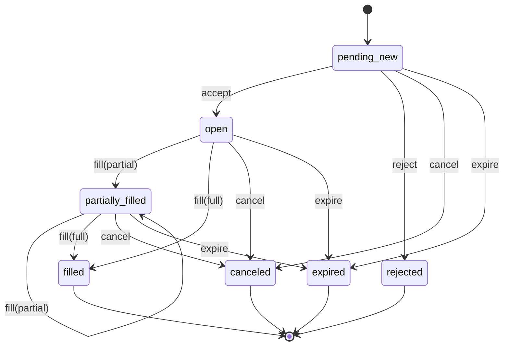

# @kurumi/finance 形式化契约

> 版本：0.1.0  
> 范围：`packages/finance/src`（货币与金额、金融标的、行情、订单、成交、持仓、组合、FX、期权域封装/衍生品、基本面、固定收益、公司行为、风控、撮合与只读 provider）。  
> 判定：本包承载资金/交易、订单状态机、持仓与组合估值，属于**资金/交易类模块**与**对外契约类模块**，**不适用** FSVDD §1.2 的纯文档/构建配置豁免。FSVDD 中推荐的属性测试、状态机全路径遍历、边界值测试与变异证伪原则在本包全部升级为强制。

## 1. 范围与职责边界

`@kurumi/finance` 负责：

- 通过 `@kurumi/math` 的 `Decimal` 表示价格、数量、金额与费率；本包不重复实现定点数学；
- 定义货币、金额、现货/股票/加密货币/FX/期货/永续/期权标的及合约规格；
- 定义并校验行情快照：报价、成交、K 线、盘口与增量盘口；
- 定义订单状态机、成交回报、订单数量/价格不变量；
- 计算持仓成本、已实现/未实现盈亏、手续费与组合权益；
- 提供确定性 FX 换算（直接、反向、多跳）；
- 提供期权域封装：内在价值、货币性、盈亏平衡与到期损益；Black-Scholes/Greeks/隐含波动率数学由 `@kurumi/math` 提供；
- 提供期货基差、永续资金费、保证金与强平价格估算；
- 提供股票/企业基本面分析：三大财务报表、财务比率、成长性、DuPont、Piotroski F-score 与相对估值倍数；
- 复用 `@kurumi/math` 的 CAPM/WACC/DCF/Gordon/NPV/IRR/安全边际与统计/风险度量；
- 提供固定收益：债券现金流、应计利息、净价/全价、YTM、久期、凸性与 DV01；
- 复用 `@kurumi/math` 的绩效与风险统计，并在本包重新导出；
- 提供公司行为：拆股、股票股利、现金分红与历史价格/数量调整；
- 提供下单前风控检查、组合风险检查与基于报价的撮合模拟；
- 通过只读的 `MarketDataProvider` / `ReferenceDataProvider` / `FundamentalDataProvider` / `FxRateProvider` / `BondDataProvider` 契约为数据适配器提供边界。

`@kurumi/finance` 不负责：

- 真实交易所 HTTP/WebSocket 适配器、鉴权与限频（由 provider 包或应用实现接口）；
- 任何下单、撤单、改单、账户划转或交易执行类 provider；v0.1 的 provider 层严格只读；
- 撮合引擎的完整价格-时间优先队列、清算所结算与会计总账；
- 税务、并购/换股/供股等复杂公司行为与多币种合并报表；
- 策略、指标、回测框架与数据存储；
- 依赖 `node:`、`console.*` 或任何第三方运行时库；主入口保持跨 runtime。

## 2. 类型与不变量

### 2.1 核心类型

```text
Decimal            = { units: bigint, scale: int }         // 由 @kurumi/math 提供，规范化后无尾随零
Currency           = { code: string, decimals: int }       // 例如 USD/2、BTC/8
Money              = { amount: Decimal, currency: Currency }
AssetClass         = equity | crypto | fx | future | perpetual | option | index
Instrument         = Spot | Fx | Future | Perpetual | Option // 判别联合
Quote              = { instrument, bid, ask, bidSize, askSize, timestampMs }
Trade              = { instrument, price, quantity, side, timestampMs, tradeId? }
Bar                = { instrument, interval, openTimeMs, closeTimeMs, open, high, low, close, volume }
OrderBookSnapshot  = { instrument, bids[], asks[], timestampMs, sequence }
OrderBookDelta     = { instrument, bids[], asks[], timestampMs, sequence }
Order              = { id, instrument, side, type, timeInForce, quantity, filledQuantity,
                       remainingQuantity, filledNotional, limitPrice?, stopPrice?, status,
                       createdAtMs, updatedAtMs, rejectReason? }
Fill               = { id, orderId, instrument, side, price, quantity, timestampMs, fee?, liquidity? }
Position           = { instrument, netQuantity, averageEntryPrice, grossRealizedPnl, fees, updatedAtMs }
Portfolio          = { baseCurrency, cash: {code -> CashBalance}, positions: {key -> Position}, updatedAtMs }
FxRate             = { base, quote, rate, timestampMs }
FiscalPeriod       = { fiscalYear, periodType, startMs, endMs, currency }
FinancialStatements= { period, income, balance, cashFlow }
FundamentalRatios  = { currentRatio?, quickRatio?, ..., returnOnEquity?, ... }
ValuationMultiples = { marketCap?, enterpriseValue?, peRatio?, ..., pegRatio? }
BondSpec           = { id, faceValue, couponRate, couponFrequency, issueDateMs, maturityDateMs, dayCount, currency }
BondCashFlow       = { dateMs, coupon: Money, principal: Money, total: Money }
PerformanceMetrics = { cumulativeReturn, annualizedReturn?, volatility?, sharpe?, sortino?, maxDrawdown? }
```

### 2.2 系统不变量

| 编号        | 不变量                                                                                                                                                                         |
| ----------- | ------------------------------------------------------------------------------------------------------------------------------------------------------------------------------ |
| `I-FIN-001` | 所有账务数值由 `@kurumi/math` 的 `Decimal` 表示；finance 账务路径禁止使用浮点四则运算计算价格、数量、金额、盈亏与费率；固定收益定价的 Float64 折现因子属于模型层并须显式标注。 |
| `I-FIN-002` | `Decimal` 的规范化、scale 与位数上限由 `@kurumi/math` 保证（`abs(units) < 10^1024`）；finance 不得构造非规范 Decimal 或绕过数学包校验。                                        |
| `I-FIN-003` | 所有工厂返回递归冻结对象；调用方输入不被修改；金额、标的、订单、持仓、组合、行情快照不共享可变引用。                                                                           |
| `I-FIN-004` | 同币种运算不得混用不同 `Currency` 定义（code 或 decimals 不同即失败）；跨币种必须显式经过 FX 换算。                                                                            |
| `I-FIN-005` | 订单状态机终态为 `filled` / `canceled` / `rejected` / `expired`；终态不可再接受任何事件；非法转移必须显式抛错，不得静默忽略。                                                  |
| `I-FIN-006` | 任意时刻订单满足 `filledQuantity + remainingQuantity == quantity`、`filledQuantity >= 0`、`remainingQuantity >= 0`、`filledNotional >= 0`。                                    |
| `I-FIN-007` | 持仓满足 `netQuantity == Σ(signed fill quantity)`；`netQuantity == 0` 时 `averageEntryPrice == 0`；手续费币种必须与标的计价币种一致。                                          |
| `I-FIN-008` | 盘口始终有序：买盘价格严格递减、卖盘价格严格递增、同侧价格唯一、数量为正、最优买价 < 最优卖价；增量序列必须连续。                                                              |
| `I-FIN-009` | FX 换算路径确定：同一组汇率、同一 from/to 必须得到同一路径与同一结果；不允许隐式选择冲突的正反向汇率。                                                                         |
| `I-FIN-010` | 期权定价模型使用 Float64 超越函数，仅用于估值/风控；其输出不得直接作为结算金额，结算金额必须由交易所/清算方给定并转为 `Decimal`。                                              |
| `I-FIN-011` | 所有随机/时间依赖输入由参数注入；核心函数不读取系统时间、不发起网络请求、不写全局状态。                                                                                        |
| `I-FIN-012` | 错误必须带稳定 `code` 与定位上下文；风险检查返回完整违规列表而不是在第一条违规处静默短路。                                                                                     |
| `I-FIN-013` | 财务报表必须满足会计恒等式：资产 = 负债 + 所有者权益；利润表与现金流量表的合计行必须由原始行项目推导，不允许调用方传入不一致的合计。                                           |
| `I-FIN-014` | 财务比率在分母为零或经济含义不成立（如负权益的 ROE、负收入的净利率）时返回 `undefined`，不得返回 `Infinity`/`NaN` 或静默给出误导值。                                           |
| `I-FIN-015` | 估值模型（CAPM/WACC/DCF/Gordon/NPV/IRR）、债券定价与绩效统计使用 Float64 进行模型计算；输出金额必须转为 `Decimal` 或明确标注为模型数值，不得直接进入账务。                     |
| `I-FIN-016` | 债券现金流日期必须严格递增且不晚于到期日；YTM 求解必须在有界区间内收敛，否则显式失败。                                                                                         |
| `I-FIN-017` | 绩效统计的输入序列必须全部为有限数值；价格必须 > 0；收益率序列长度与周期参数必须满足各自最小值。                                                                               |

## 3. 形式化约束矩阵

### 3.1 Decimal（由 `@kurumi/math` 提供）

Decimal 的解析、规范化、四则运算、舍入、步长与错误语义由 `@kurumi/math` 定义，契约见 [`docs/spec/math.md`](math.md) §3.1。finance 只消费 `Decimal`、`DecimalRounding` 与相关断言，不重复实现或放宽约束。

### 3.2 货币与金额（`money.ts`）

| 编号                | 约束                                                                                                              | 失败语义                     |
| ------------------- | ----------------------------------------------------------------------------------------------------------------- | ---------------------------- |
| `FC-MONEY-PRE-001`  | 货币代码匹配 `^[A-Z][A-Z0-9]{2,11}$`；`decimals` 是 `0..18` 的整数。                                              | `FinanceDefinitionError`     |
| `FC-MONEY-PRE-002`  | `Money.amount` 必须是 `Decimal`；`currency` 必须是合法 `Currency`；金额精度可高于货币展示精度。                   | `FinanceDefinitionError`     |
| `FC-MONEY-PRE-003`  | 加减、比较、求和必须使用相同 `Currency` 定义；跨币种直接运算必须失败。                                            | `CurrencyMismatchError`      |
| `FC-MONEY-POST-001` | `addMoney` / `subtractMoney` / `sumMoney` 返回冻结的新对象，金额精确；`negateMoney` / `absMoney` 保持币种。       | —                            |
| `FC-MONEY-POST-002` | `multiplyMoney` / `divideMoney` 保持币种，除法默认 scale 18、`half-even`；结果不修改入参。                        | `DecimalDivisionByZeroError` |
| `FC-MONEY-POST-003` | `formatMoney` 缺省使用货币 decimals 与 `half-even`，输出 `<amount> <CODE>`；显式 decimals 不得越界。              | `FinanceDefinitionError`     |
| `FC-MONEY-POST-004` | `moneyToJson` 输出 `{ amount: string, currency: code, decimals: number }`；`moneyFromJson` 可还原金额并校验结构。 | `FinanceDefinitionError`     |

### 3.3 金融标的（`instrument.ts`）

| 编号               | 约束                                                                                                                                                    | 失败语义                 |
| ------------------ | ------------------------------------------------------------------------------------------------------------------------------------------------------- | ------------------------ |
| `FC-INST-PRE-001`  | `venue` 小写规范化后匹配 `^[a-z0-9][a-z0-9._-]{0,31}$`；`symbol` 大写规范化后匹配 `^[A-Z0-9][A-Z0-9._/-]{0,63}$`；`baseAsset`/`underlying` 非空且合法。 | `FinanceDefinitionError` |
| `FC-INST-PRE-002`  | `tickSize > 0`、`lotSize > 0`、`contractMultiplier > 0`；`minQuantity`/`maxQuantity` 若提供必须为正、是 lotSize 的整数倍且 `min <= max`。               | `FinanceDefinitionError` |
| `FC-INST-PRE-003`  | `settlementCurrency` 必须与 `quoteCurrency` 完全一致（v0.1 不支持 quanto/非计价币种结算）；`minNotional` 币种必须等于 quote。                           | `FinanceDefinitionError` |
| `FC-INST-PRE-004`  | FX 的 base/quote 不得相同；Future/Perpetual/Option 的 `expiryMs`/`fundingIntervalMs` 必须为正安全整数；Option 的 `strike > 0`；`isTradable` 缺省 true。 | `FinanceDefinitionError` |
| `FC-INST-POST-001` | `instrumentKey` 稳定为 `${venue}:${symbol}`；注册表拒绝重复 key；`list()` 返回冻结快照。                                                                | `FinanceDefinitionError` |
| `FC-INST-POST-002` | `notionalMoney` 等于 `price * quantity * contractMultiplier`，币种为 quote，要求 price > 0、quantity >= 0。                                             | `FinanceDefinitionError` |
| `FC-INST-POST-003` | `isPriceValid` 要求价格 > 0 且是 tickSize 的整数倍；`isQuantityValid` 要求数量 > 0、是 lotSize 的整数倍并满足 min/max。                                 | —                        |
| `FC-INST-POST-004` | `roundPrice` / `roundQuantity` 输出为 step 的整数倍；价格默认 `half-even`，数量默认 `down`，不得超出原始数量。                                          | —                        |

### 3.4 行情（`market-data.ts`）

| 编号             | 约束                                                                                                                                                                                     | 失败语义                    |
| ---------------- | ---------------------------------------------------------------------------------------------------------------------------------------------------------------------------------------- | --------------------------- |
| `FC-MD-PRE-001`  | Quote：bid/ask > 0、价格满足 tickSize、bidSize/askSize >= 0、`bid < ask`、timestamp 为非负安全整数。                                                                                     | `MarketDataValidationError` |
| `FC-MD-PRE-002`  | Trade：price > 0 且满足 tickSize、quantity > 0、side 合法、timestamp 合法、tradeId 若提供必须非空。                                                                                      | `MarketDataValidationError` |
| `FC-MD-PRE-003`  | Bar：`closeTimeMs - openTimeMs == intervalMs`；O/H/L/C > 0 且满足 tickSize；`high >= max(open, close, low)`、`low <= min(open, close, high)`；volume >= 0；tradeCount 若提供为非负整数。 | `MarketDataValidationError` |
| `FC-MD-PRE-004`  | OrderBook：买盘严格递减、卖盘严格递增、同侧价格唯一、数量 > 0、价格满足 tickSize、最优买价 < 最优卖价；空盘口合法；单侧最多 1000 档。                                                    | `MarketDataValidationError` |
| `FC-MD-PRE-005`  | OrderBookDelta：sequence 必须等于 snapshot.sequence + 1；delta 内同侧价格唯一；quantity = 0 表示删除，quantity < 0 非法；应用后必须仍满足盘口不变量。                                    | `MarketDataValidationError` |
| `FC-MD-POST-001` | `quoteMid`、`quoteSpread`、`quoteSpreadBps` 由 bid/ask 精确推导；`quoteSpreadBps` 使用 scale 8、`half-even`。                                                                            | —                           |
| `FC-MD-POST-002` | `barRange`、`barTypicalPrice`、`barNotional`、`barIsBullish` 为纯函数；`barNotional` 使用典型价 * volume * multiplier。                                                                  | —                           |
| `FC-MD-POST-003` | `bookBestBid` / `bookBestAsk` 对空盘口返回 undefined；`bookDepthNotional`、`bookImbalance` 对空盘口返回零。                                                                              | —                           |
| `FC-MD-POST-004` | `applyOrderBookDelta` 返回新快照，不修改原快照；删除/更新/新增档位后重新排序并再次校验。                                                                                                 | —                           |

### 3.5 订单状态机（`order.ts`）

```text
M = (States, Events, Transition_Function, Initial_State, Final_States)
States  = { pending_new, open, partially_filled, filled, canceled, rejected, expired }
Events  = { accept, reject, cancel, expire, fill }
Initial = pending_new
Final   = { filled, canceled, rejected, expired }
```

| 当前状态           | 事件   | 下一状态                      | 约束 / 副作用                            |
| ------------------ | ------ | ----------------------------- | ---------------------------------------- |
| `pending_new`      | accept | `open`                        | timestamp >= updatedAt                   |
| `pending_new`      | reject | `rejected`                    | reason 非空；记录 rejectReason           |
| `pending_new`      | cancel | `canceled`                    | timestamp >= updatedAt                   |
| `pending_new`      | expire | `expired`                     | timestamp >= updatedAt                   |
| `open`             | fill   | `partially_filled` / `filled` | fill 数量 <= remaining；价格满足限价约束 |
| `open`             | cancel | `canceled`                    | —                                        |
| `open`             | expire | `expired`                     | —                                        |
| `partially_filled` | fill   | `partially_filled` / `filled` | 同上                                     |
| `partially_filled` | cancel | `canceled`                    | —                                        |
| `partially_filled` | expire | `expired`                     | —                                        |
| 终态               | 任意   | —                             | 抛 `OrderStateError`，不得静默忽略       |

| 编号              | 约束                                                                                                                             | 失败语义                                           |
| ----------------- | -------------------------------------------------------------------------------------------------------------------------------- | -------------------------------------------------- |
| `FC-ORD-PRE-001`  | 订单 id/clientOrderId 匹配安全字符集与长度；quantity > 0 且满足 lot/min/max；`isTradable !== false`。                            | `FinanceDefinitionError`                           |
| `FC-ORD-PRE-002`  | 订单类型与价格字段矩阵：market 无 limit/stop；limit 必须有 limit；stop 必须有 stop；stop-limit 两者都有；所有价格满足 tickSize。 | `FinanceDefinitionError`                           |
| `FC-ORD-PRE-003`  | Fill：id/orderId 非空、price > 0 且满足 tick、quantity > 0、timestamp 合法、fee 若提供币种必须为 quote。                         | `FinanceDefinitionError` / `CurrencyMismatchError` |
| `FC-ORD-PRE-004`  | 事件时间戳必须是非负安全整数且 >= 订单 `updatedAtMs`；fill 的 orderId、instrument、side、fee 币种必须与订单一致。                | `OrderStateError` / `CurrencyMismatchError`        |
| `FC-ORD-PRE-005`  | fill 数量不得超过 remaining；超过即失败且不得产生部分状态。                                                                      | `OrderOverfillError`                               |
| `FC-ORD-PRE-006`  | limit/stop-limit 订单的成交价必须不劣于限价：buy price <= limit，sell price >= limit。                                           | `OrderStateError`                                  |
| `FC-ORD-POST-001` | `applyOrderEvent` 是唯一状态转移入口；成功返回冻结新订单，不修改旧订单。                                                         | —                                                  |
| `FC-ORD-POST-002` | `filledNotional = Σ(fill.price * fill.quantity)`（不含 multiplier）；`remainingQuantity = quantity - filledQuantity`。           | —                                                  |
| `FC-ORD-POST-003` | `orderAverageFillPrice` 在无成交时返回 undefined，否则 `filledNotional / filledQuantity`（scale 18、half-even）。                | —                                                  |
| `FC-ORD-POST-004` | `orderFilledNotional` 返回 `filledNotional * contractMultiplier` 的 quote Money。                                                | —                                                  |
| `FC-ORD-INV-001`  | 对任意合法事件序列，`filledQuantity + remainingQuantity == quantity` 恒成立；终态后任何事件均失败。                              | —                                                  |

### 3.6 持仓与盈亏（`position.ts`）

| 编号              | 约束                                                                                                                                                                                                   | 失败语义                                                                  |
| ----------------- | ------------------------------------------------------------------------------------------------------------------------------------------------------------------------------------------------------ | ------------------------------------------------------------------------- |
| `FC-POS-PRE-001`  | fill 的 instrument 必须与持仓一致；price > 0、quantity > 0、timestamp >= position.updatedAtMs；fee 币种必须为 quote。                                                                                  | `InstrumentMismatchError` / `CurrencyMismatchError` / `FinanceValueError` |
| `FC-POS-POST-001` | 同向加仓：`averageEntryPrice = (oldAvg*abs(oldQty) + fillPrice*fillQty) / (abs(oldQty) + fillQty)`，scale 18、half-even；净数量为两者绝对值之和。                                                      | —                                                                         |
| `FC-POS-POST-002` | 反向减仓：仅对 `closedQty = min(abs(oldQty), fillQty)` 计算已实现盈亏；long 为 `(fillPrice - avg) * closedQty * multiplier`，short 为 `(avg - fillPrice) * closedQty * multiplier`；剩余仓位均价不变。 | —                                                                         |
| `FC-POS-POST-003` | 反向穿透（flip）：先按 `closedQty` 结算，剩余数量按 fillPrice 建立反向仓位；`averageEntryPrice = fillPrice`。                                                                                          | —                                                                         |
| `FC-POS-POST-004` | 净数量归零时 `averageEntryPrice = 0`；已实现盈亏与手续费保留。                                                                                                                                         | —                                                                         |
| `FC-POS-POST-005` | `unrealizedPnl = (markPrice - averageEntryPrice) * netQuantity * contractMultiplier`；空仓返回零。                                                                                                     | —                                                                         |
| `FC-POS-POST-006` | `totalPnl = grossRealizedPnl + unrealizedPnl - fees`；`positionNotional = abs(netQuantity) * markPrice * multiplier`。                                                                                 | —                                                                         |
| `FC-POS-INV-001`  | `netQuantity` 恒等于所有已应用 fill 的有符号数量之和；`positionFromFills` 重放结果与逐次应用一致。                                                                                                     | —                                                                         |

### 3.7 组合与估值（`portfolio.ts`）

| 编号             | 约束                                                                                                                              | 失败语义                                       |
| ---------------- | --------------------------------------------------------------------------------------------------------------------------------- | ---------------------------------------------- |
| `FC-PF-PRE-001`  | 组合 baseCurrency 合法；cash/positions 键与内部 currency/instrument key 一致；所有时间戳非负安全整数。                            | `FinanceDefinitionError` / `PortfolioError`    |
| `FC-PF-PRE-002`  | `applyFillToPortfolio` 的 fill timestamp >= portfolio.updatedAtMs；fee 币种必须为 quote。                                         | `FinanceValueError` / `CurrencyMismatchError`  |
| `FC-PF-PRE-003`  | 估值必须为每个非空持仓提供 mark price；跨币种估值必须提供 FX converter；缺失时显式失败。                                          | `MissingMarkPriceError` / `MissingFxRateError` |
| `FC-PF-POST-001` | 现货/期权（equity/crypto/fx/index/option）：成交现金流为 `-signedQty * price * multiplier - fee`；持仓按市值计入权益。            | —                                              |
| `FC-PF-POST-002` | 期货/永续（future/perpetual）：成交现金流为 `realizedPnlDelta - fee`；持仓按未实现盈亏计入权益。                                  | —                                              |
| `FC-PF-POST-003` | `portfolioEquity = Σ cash(折算 base) + Σ positionValue(折算 base)`；现货/期权 positionValue 为带符号市值，期货/永续为未实现盈亏。 | —                                              |
| `FC-PF-POST-004` | `portfolioGrossExposure` 为各持仓名义价值的绝对值之和；`portfolioNetExposure` 为带符号名义价值之和；均折算 base。                 | —                                              |
| `FC-PF-POST-005` | `depositCash` / `withdrawCash` 不修改入参；默认允许透支（保证金账户），显式 `shouldAllowOverdraft=false` 时余额不足必须失败。     | `PortfolioError`                               |
| `FC-PF-INV-001`  | 同一 fill 序列在 portfolio 与 position 上得到的仓位数量、已实现盈亏、手续费完全一致。                                             | —                                              |

### 3.8 FX（`fx.ts`）

| 编号             | 约束                                                                                                                      | 失败语义                |
| ---------------- | ------------------------------------------------------------------------------------------------------------------------- | ----------------------- |
| `FC-FX-PRE-001`  | base/quote 不得相同；rate > 0；timestamp 合法；同一转换器不得同时出现 A/B 与 B/A 或重复同向汇率。                         | `FxRateError`           |
| `FC-FX-PRE-002`  | 转换要求源/目标货币合法；相同 code 但 decimals 不同视为币种不一致；任何缓存 key 必须包含完整货币定义（code + decimals）。 | `CurrencyMismatchError` |
| `FC-FX-POST-001` | `rate(from, to)` 使用确定性 BFS：邻居按目标 code 升序；多跳每步乘积累积到 scale 18、half-even；无路径抛错。               | `MissingFxRateError`    |
| `FC-FX-POST-002` | `convert` 默认按目标货币 decimals 舍入（half-even），显式 scale 优先；返回新 Money，不修改入参。                          | —                       |
| `FC-FX-POST-003` | `invertFxRate` 交换 base/quote 并以 scale 18、half-even 计算倒数。                                                        | —                       |
| `FC-FX-INV-001`  | 直接汇率与反向汇率互为近似倒数；多跳路径结果与逐步转换在舍入误差范围内一致。                                              | —                       |

### 3.9 期权与衍生品（`option.ts`、`derivatives.ts`）

期权定价数学（内在价值、货币性、盈亏平衡、Black-Scholes、Greeks、隐含波动率）由 `@kurumi/math` 定义，见 [`docs/spec/math.md`](math.md) §3.4。finance 只保留期权标的/货币封装与衍生品域指标。

| 编号              | 约束                                                                                                                                                                                     | 失败语义                                       |
| ----------------- | ---------------------------------------------------------------------------------------------------------------------------------------------------------------------------------------- | ---------------------------------------------- |
| `FC-OPT-PRE-001`  | `option` 必须是合法 `OptionInstrument`；`underlyingPrice`/`premium` 必须 > 0 / >= 0。                                                                                                    | `FinanceDefinitionError` / `FinanceValueError` |
| `FC-OPT-POST-001` | `optionIntrinsicValue` 调用 math 的纯函数并返回 Decimal；`optionIntrinsicValueMoney` 再乘 multiplier，币种为 quote。                                                                     | —                                              |
| `FC-OPT-POST-002` | `optionMoneyness = S/K`（scale 8、half-even）；`optionIsInTheMoney` 严格大于/小于 strike；`optionBreakeven` call = strike + premium、put = strike - premium。                            | —                                              |
| `FC-OPT-POST-006` | `optionPayoffAtExpiry` 等价于 `optionIntrinsicValueMoney`；不修改入参。                                                                                                                  | —                                              |
| `FC-DER-POST-001` | `futuresBasis = futuresPrice - spotPrice`；`futuresBasisRate = basis / spotPrice`（scale 8、half-even）。                                                                                | —                                              |
| `FC-DER-POST-002` | `fundingPayment = -netQuantity * markPrice * multiplier * fundingRate`；正资金费率时多头支付、空头收取。                                                                                 | —                                              |
| `FC-DER-POST-003` | `calculateMarginRequirement`：`notional = abs(qty) * price * multiplier`；initial = notional * initialRate；maintenance = notional * maintenanceRate；0 <= maintenance <= initial <= 1。 | `FinanceDefinitionError`                       |

### 3.10 风控与撮合（`risk.ts`、`simulation.ts`）

| 编号               | 约束                                                                                                                                                | 失败语义                                       |
| ------------------ | --------------------------------------------------------------------------------------------------------------------------------------------------- | ---------------------------------------------- |
| `FC-RISK-PRE-001`  | 订单风控必须检查：标的可交易、数量合法、价格合法、订单名义价值、持仓数量/名义上限、允许标的集合；返回全部违规，不因首条失败短路。                   | —                                              |
| `FC-RISK-PRE-002`  | 限额 Money 币种必须与标的 quote 一致；不一致产生 `limit_currency_mismatch` 违规，不抛错。                                                           | —                                              |
| `FC-RISK-PRE-003`  | 组合风控必须检查 gross exposure、leverage、最小权益；估值失败（缺 mark/FX）必须显式抛错。                                                           | `MissingMarkPriceError` / `MissingFxRateError` |
| `FC-RISK-POST-001` | `checkOrderRisk` 不修改订单/持仓；违规列表按固定检查顺序排列。                                                                                      | —                                              |
| `FC-RISK-POST-002` | `liquidationPrice`：long = `avg * (1 - 1/leverage + maintenanceRate)`，short = `avg * (1 + 1/leverage - maintenanceRate)`，结果不小于 0。           | `FinanceValueError`                            |
| `FC-SIM-PRE-001`   | 撮合只接受 open/partially_filled 订单；Quote 与订单标的必须一致；stop 订单必须提供 `lastPrice`。                                                    | `FinanceValueError`                            |
| `FC-SIM-POST-001`  | market buy 以 ask、market sell 以 bid 成交；limit buy 仅在 ask <= limit 时以 ask 成交，limit sell 仅在 bid >= limit 时以 bid 成交；成交价取更优价。 | —                                              |
| `FC-SIM-POST-002`  | 成交数量 = min(remaining, 盘口数量, 可选 maxQuantity)；FOK 若不能全部成交返回 undefined；其余情况可部分成交。                                       | —                                              |
| `FC-SIM-POST-003`  | `isStopTriggered`：buy stop 在 lastPrice >= stopPrice 时触发，sell stop 在 lastPrice <= stopPrice 时触发。                                          | —                                              |

### 3.11 基本面与财务报表（`fundamentals.ts`）

| 编号               | 约束                                                                                                                                                                                                                                                               | 失败语义                 |
| ------------------ | ------------------------------------------------------------------------------------------------------------------------------------------------------------------------------------------------------------------------------------------------------------------ | ------------------------ |
| `FC-FUND-PRE-001`  | `FiscalPeriod.fiscalYear` 为 >= 1900 的整数；periodType 属于 annual/quarterly/ttm；`startMs < endMs`；货币合法。                                                                                                                                                   | `FinanceDefinitionError` |
| `FC-FUND-PRE-002`  | 利润表：revenue/costOfRevenue/operatingExpenses/interestExpense/taxExpense >= 0；sharesOutstanding > 0；EPS 可负。                                                                                                                                                 | `FinanceDefinitionError` |
| `FC-FUND-PRE-003`  | 资产负债表：资产与负债行项目 >= 0；所有者权益可负；必须满足 `totalAssets == totalLiabilities + shareholdersEquity`（精确 Decimal 比较）。                                                                                                                          | `FinanceDefinitionError` |
| `FC-FUND-PRE-004`  | 现金流量表：capitalExpenditure/depreciationAmortization/dividendsPaid/shareRepurchases >= 0；其余现金流可负。                                                                                                                                                      | `FinanceDefinitionError` |
| `FC-FUND-POST-001` | 利润表推导：`grossProfit = revenue - costOfRevenue`；`operatingIncome = grossProfit - operatingExpenses`；`pretaxIncome = operatingIncome + otherIncome - interestExpense`；`netIncome = pretaxIncome - taxExpense`；EPS 缺省按 netIncome/sharesOutstanding 计算。 | —                        |
| `FC-FUND-POST-002` | 资产负债表推导：currentAssets、totalAssets、currentLiabilities、totalLiabilities、totalLiabilitiesAndEquity 均由行项目求和；资产恒等式必须成立。                                                                                                                   | —                        |
| `FC-FUND-POST-003` | 现金流量表推导：`freeCashFlow = operatingCashFlow - capitalExpenditure`；`netChangeInCash = operatingCashFlow + investingCashFlow + financingCashFlow`。                                                                                                           | —                        |
| `FC-FUND-POST-004` | `computeFundamentalRatios` 返回流动/速动/现金比率、营运资本、负债率、利息保障、毛利率/营业利润率/净利率、ROA/ROE/ROIC、周转率、DIO/DSO、FCF 利润率、EPS/BVPS/FCFPS、分红率与有效税率；分母不成立时字段缺省。                                                       | —                        |
| `FC-FUND-POST-005` | `computeGrowthMetrics` 使用上一期计算收入/净利润/EPS/FCF/权益增长率；上期分母 <= 0 时对应字段缺省。                                                                                                                                                                | —                        |
| `FC-FUND-POST-006` | `computeDuPont` 同时给出三因子与五因子分解；因子或权益 <= 0 时对应字段缺省；五因子连乘的每个中间结果使用 scale 8、`half-even`，不得因自然 scale 累积超过 Decimal 上限。                                                                                            | —                        |
| `FC-FUND-POST-007` | `computeValuationMultiples` 以价格 * 股数计算市值，以市值 + 净债务计算 EV；净利润/权益/收入/EBITDA 非正时对应倍数缺省；PEG = PE / (growthRate * 100)。                                                                                                             | —                        |
| `FC-FUND-POST-008` | `computePiotroskiFScore` 返回 0..9 分与 9 项布尔准则；任一期所需比率缺失时该准则为 false。                                                                                                                                                                         | —                        |

### 3.12 估值模型（由 `@kurumi/math` 提供）

CAPM、WACC、DCF、Gordon、NPV/IRR、折现因子、每股价值与安全边际由 `@kurumi/math` 定义，契约见 [`docs/spec/math.md`](math.md) §3.3。finance 重新导出这些函数，供金融域应用直接使用。

### 3.13 固定收益（`fixed-income.ts`）

| 编号             | 约束                                                                                                                                                      | 失败语义                                      |
| ---------------- | --------------------------------------------------------------------------------------------------------------------------------------------------------- | --------------------------------------------- |
| `FC-FI-PRE-001`  | BondSpec：id 非空、faceValue > 0、couponRate >= 0、frequency 属于 1/2/4/12、issueDateMs < maturityDateMs、dayCount 合法、货币合法。                       | `FinanceDefinitionError`                      |
| `FC-FI-PRE-002`  | settlement 必须位于 `[issueDateMs, maturityDateMs)`；价格/收益率必须有限；YTM 求解区间必须覆盖目标价格；`cleanPrice.currency` 必须等于 `bond.currency`。  | `FinanceValueError` / `CurrencyMismatchError` |
| `FC-FI-POST-001` | `couponSchedule` 返回严格递增、位于 issue 之后且不晚于 maturity 的付息日；最后一日等于 maturity。                                                         | —                                             |
| `FC-FI-POST-002` | `couponPerPeriod = faceValue * couponRate / frequency`；零息债返回零。                                                                                    | —                                             |
| `FC-FI-POST-003` | `accruedInterest = couponPerPeriod * 应计天数 / 付息周期天数`；结算日等于 issue 时为 0；日计数支持 actual/actual、actual/360、actual/365、30/360。        | —                                             |
| `FC-FI-POST-004` | `bondDirtyPrice` 为剩余 coupon 与本金按 `(1+y)^t` 折现之和；`bondCleanPrice = dirty - accrued`；`bondYield` 反解使 clean price 等于目标价格的年化收益率。 | —                                             |
| `FC-FI-POST-005` | Macaulay 久期、修正久期、凸性与 DV01 均由剩余现金流与 dirty price 推导；空现金流或非正 dirty price 时显式失败。                                           | —                                             |
| `FC-FI-POST-006` | `currentYield = 年化票息 / cleanPrice`；`bondCashFlows` 返回冻结的 coupon/principal/total 现金流列表。                                                    | —                                             |

### 3.14 绩效与风险统计（由 `@kurumi/math` 提供）

收益、年化、波动率、Sharpe/Sortino、最大回撤、Beta/Alpha、跟踪误差与 VaR/CVaR 由 `@kurumi/math` 定义，契约见 [`docs/spec/math.md`](math.md) §3.2。finance 重新导出这些函数。

### 3.15 公司行为（`corporate-actions.ts`）

| 编号             | 约束                                                                                                                         | 失败语义                 |
| ---------------- | ---------------------------------------------------------------------------------------------------------------------------- | ------------------------ |
| `FC-CA-PRE-001`  | 拆股/股票股利 ratio > 0；现金分红每股金额 >= 0；exDateMs 为非负安全整数；现金分红币种合法。                                  | `FinanceDefinitionError` |
| `FC-CA-POST-001` | `adjustPriceForSplit(price, ratio) = price / ratio`；`adjustQuantityForSplit(quantity, ratio) = quantity * ratio`。          | —                        |
| `FC-CA-POST-002` | `adjustHistoricPrices` 对每个 exDate 之后的拆股/股票股利，将之前的价格除以累计 ratio；不修改输入。                           | —                        |
| `FC-CA-POST-003` | `totalReturnWithDividends(startPrice, endPrice, dividendsPerShare) = (end - start + dividends)/start`；startPrice 必须 > 0。 | —                        |

### 3.16 只读数据提供方（`provider/`）

| 编号               | 约束                                                                                                                                                     | 失败语义           |
| ------------------ | -------------------------------------------------------------------------------------------------------------------------------------------------------- | ------------------ |
| `FC-PROV-PRE-001`  | `provider/` 只允许查询方法；不得出现 `submitOrder` / `cancelOrder` / `executeOrder` / `placeOrder` 等写操作或交易执行契约。                              | 架构测试失败       |
| `FC-PROV-PRE-002`  | 所有异步方法接受可选 `AbortSignal`；返回对象必须是 finance 模块已校验的冻结值，不得返回未校验的供应商 DTO。                                              | —                  |
| `FC-PROV-PRE-003`  | HTTP 层必须统一包装网络/非 2xx 为 `ProviderHttpError`，JSON/CSV 解析失败为 `ProviderDataError`；不支持的能力显式抛 `UnsupportedProviderOperationError`。 | 对应 provider 错误 |
| `FC-PROV-PRE-004`  | `MarketDataProvider` 的 quote/ticker/order book/bars/trades 均为可选能力；调用方必须先检查方法是否存在。                                                 | —                  |
| `FC-PROV-POST-001` | 提供方按领域拆分：行情、参考数据、基本面、FX、期权、债券/收益率曲线；桶入口 `provider/index.ts` 只做类型/工具 re-export。                                | —                  |
| `FC-PROV-POST-002` | 行情提供方只提供 quote/ticker/order book/bars/trades；基本面提供方只提供 company profile/financial statements；FX/期权/债券提供方只读。                  | —                  |
| `FC-PROV-POST-003` | provider 包不得包含账户、下单、撤单、资金划转或交易执行能力；`fetchImpl`/`timeoutMs`/`headers` 可注入以便测试与代理。                                    | —                  |

`providers/` 下的公开数据源适配器：

| 包                    | 领域                 | 公开数据源                             |
| --------------------- | -------------------- | -------------------------------------- |
| `@kurumi/nasdaq`      | 美股行情、股票期权   | `api.nasdaq.com`                       |
| `@kurumi/binance`     | 现货、永续/期货      | `api.binance.com` / `fapi.binance.com` |
| `@kurumi/frankfurter` | FX 汇率与 FX 日线    | `api.frankfurter.app` (ECB)            |
| `@kurumi/us-treasury` | 固定收益收益率曲线   | `home.treasury.gov`                    |
| `@kurumi/sec-edgar`   | 美股参考数据、基本面 | `sec.gov` / `data.sec.gov`             |

各 provider 的适配器级约束、边界与追溯矩阵见 [`nasdaq.md`](nasdaq.md)、[`binance.md`](binance.md)、[`frankfurter.md`](frankfurter.md)、[`us-treasury.md`](us-treasury.md)、[`sec-edgar.md`](sec-edgar.md)；Agent 工具契约见 [`finance-tools.md`](finance-tools.md)。

## 4. 状态机与序列

### 4.1 订单状态机



### 4.2 盘口增量序列

`applyOrderBookDelta(snapshot, delta)` 要求 `delta.sequence == snapshot.sequence + 1`；任何跳号、回退或重复序列都必须失败，避免在缺口上继续维护错误盘口。

## 5. 错误分类

| 类型 / code                                                  | 触发条件                               | 关键上下文                               |
| ------------------------------------------------------------ | -------------------------------------- | ---------------------------------------- |
| `FinanceError` / `finance_error`                             | 金融包错误基类                         | `cause`                                  |
| `FinanceDefinitionError` / `finance_definition_error`        | 工厂输入、选项、标的规格、订单字段非法 | 直接消息                                 |
| `FinanceValueError` / `finance_value_error`                  | 运行时值域/时序/估值错误               | 直接消息                                 |
| `CurrencyMismatchError` / `currency_mismatch`                | 币种定义不一致                         | `expectedCurrency`、`actualCurrency`     |
| `InstrumentMismatchError` / `instrument_mismatch`            | 标的 key 不一致                        | `expectedInstrument`、`actualInstrument` |
| `MarketDataValidationError` / `market_data_validation_error` | 行情结构/价格/盘口/序列非法            | 消息、`cause`                            |
| `OrderStateError` / `order_state_error`                      | 非法订单状态转移、时间倒退、限价违规   | `orderId`、`from`、`event`               |
| `OrderOverfillError` / `order_overfill`                      | 成交数量超过剩余数量                   | `orderId`、`remaining`、`fillQuantity`   |
| `FxRateError` / `fx_rate_error`                              | 汇率定义非法/冲突                      | 消息                                     |
| `MissingFxRateError` / `missing_fx_rate`                     | 换算路径不存在                         | `fromCurrency`、`toCurrency`             |
| `MissingMarkPriceError` / `missing_mark_price`               | 组合估值缺少 mark price                | `instrumentKey`                          |
| `PortfolioError` / `portfolio_error`                         | 组合余额/结构/估值错误                 | 直接消息                                 |
| `ProviderError` / `provider_error`                           | 数据提供方错误基类                     | `providerId`                             |
| `ProviderHttpError` / `provider_http_error`                  | 网络、超时或非 2xx 响应                | `providerId`、`url`、`status`、`cause`   |
| `ProviderDataError` / `provider_data_error`                  | 响应结构/字段/解析非法                 | `providerId`、`cause`                    |
| `UnsupportedProviderOperationError` / `provider_unsupported` | 数据源不支持该只读能力                 | `providerId`、`operation`                |

`DecimalParseError`、`DecimalRoundingError`、`DecimalDivisionByZeroError`、`DecimalOverflowError` 与 `OptionModelError` 由 `@kurumi/math` 定义并由 finance 透传；它们继承 `MathError`，不继承 `FinanceError`。

## 6. 边界与采样

- Decimal/统计/估值/期权定价边界：见 [`docs/spec/math.md`](math.md) §5。
- 金额：0、负数、极小值、超展示精度、同 code 不同 decimals、跨币种加减、除零、格式化边界。
- 标的：最小/最大 tick 与 lot、非整数倍价格/数量、min > max、min 不是 lot 倍数、FX 同币种、期权 strike 0/负数、期货 expiry 0、注册表重复 key。
- 行情：空盘口、单侧盘口、交叉盘口、重复档位、乱序档位、增量跳号/回退、K 线高低于 O/C、时间区间不匹配、负成交量。
- 订单：pending/open/partially_filled/终态 × 全部事件；超量成交、限价违规、时间倒退、错误 orderId/instrument/side、零/负数量、market 带 limit、limit 缺 limit、stop 缺 stop。
- 持仓：开仓、加仓、部分减仓、全部平仓、反向穿透、零数量、负价格、跨标的、跨币种手续费、重复时间戳、回退时间戳。
- 组合：现货/期货/期权现金流、现金存取、透支、缺 mark、缺 FX、多币种权益、空组合。
- FX：直接/反向/多跳、冲突汇率、重复汇率、无路径、同币种、舍入边界。
- 风控/撮合：每条限额单独触发、组合违规、允许标的集合、stop 未触发/已触发、FOK 不足、盘口零数量。
- 基本面：资产恒等式差 0.01、负收入、零股数、负权益、上期分母为 0、缺失比率、Piotroski 全 0/全 9。
- 固定收益：零息债、到期日结算、最后一个付息日、闰年、30/360 月末、YTM 价格越界、负收益率。
- 绩效/估值/期权数学：见 [`docs/spec/math.md`](math.md) §5。
- 公司行为：ratio 0/负数、除权日边界、多次拆股累计、现金分红为 0。
- provider：HTTP 4xx/5xx、超时、非 JSON/CSV、缺失字段、限频、无 User-Agent、不支持的周期/能力。

## 7. 追溯矩阵

| 约束                                    | 测试文件 / 用例                                                                                         |
| --------------------------------------- | ------------------------------------------------------------------------------------------------------- |
| `FC-DEC-*` / `I-FIN-001` / `I-FIN-002`  | 已迁移至 `@kurumi/math`：`packages/math/src/decimal.test.ts`、`decimal.properties.test.ts`              |
| `FC-MONEY-*` / `I-FIN-004`              | `src/money.test.ts`                                                                                     |
| `FC-INST-*`                             | `src/instrument.test.ts`                                                                                |
| `FC-MD-*` / `I-FIN-008`                 | `src/market-data.test.ts`                                                                               |
| `FC-ORD-*` / `I-FIN-005` / `I-FIN-006`  | `src/order.test.ts`（合法转移全遍历 + 终态/非法转移矩阵）                                               |
| `FC-POS-*` / `I-FIN-007`                | `src/position.test.ts`、`src/position.properties.test.ts`                                               |
| `FC-PF-*`                               | `src/portfolio.test.ts`                                                                                 |
| `FC-FX-*` / `I-FIN-009`                 | `src/fx.test.ts`                                                                                        |
| `FC-OPT-*` / `I-FIN-010`                | `src/option.test.ts`（域封装）；数学部分见 `packages/math/src/option-math.test.ts`                      |
| `FC-DER-*`                              | `src/derivatives.test.ts`、`src/risk.test.ts`                                                           |
| `FC-RISK-*`                             | `src/risk.test.ts`                                                                                      |
| `FC-SIM-*`                              | `src/simulation.test.ts`                                                                                |
| `I-FIN-003` / `I-FIN-012`               | 各模块冻结/不修改输入断言、`src/architecture.test.ts`（无 `node:`/`console`/浮点账务）                  |
| `I-FIN-011`                             | provider 的 `nowMs`/`fetchImpl` 注入测试；核心函数不读取系统时间                                        |
| `PBT-FIN-001`                           | 已迁移至 `@kurumi/math`：`packages/math/src/decimal.properties.test.ts`                                 |
| `PBT-FIN-002`                           | `src/position.properties.test.ts` · 任意 fill 序列的净数量/重放/盈亏不变量                              |
| `FC-FUND-*` / `I-FIN-013` / `I-FIN-014` | `src/fundamentals.test.ts` · 报表推导、资产恒等式、比率、成长、DuPont、估值倍数、Piotroski              |
| `FC-VAL-*`                              | 已迁移至 `@kurumi/math`：`packages/math/src/valuation.test.ts`                                          |
| `FC-FI-*` / `I-FIN-016`                 | `src/fixed-income.test.ts` · 付息日、应计利息、净价/全价、YTM、久期/凸性/DV01                           |
| `FC-PERF-*` / `I-FIN-017`               | 已迁移至 `@kurumi/math`：`packages/math/src/statistics.test.ts`                                         |
| `FC-CA-*`                               | `src/corporate-actions.test.ts` · 拆股/股票股利/现金分红/历史价格调整                                   |
| `FC-PROV-*`                             | `src/architecture.test.ts` · provider 只读扫描；`src/provider/` 分领域契约；各适配器见 `docs/spec/*.md` |

## 8. 兼容性与演进

- 破坏性变更：修改 `OrderStatus`/事件名称、`Instrument` 判别字段、订单/持仓/组合必选字段、风险违规 code、汇率路径选择规则；`Decimal`/统计/估值/期权数学的破坏性变更由 `@kurumi/math` 契约管理。
- 非破坏性变更：新增可选字段（必须提供缺省值）、新增资产类别、新增行情类型、新增风险违规 code、放宽但不降低安全性的输入校验。
- finance 依赖 `@kurumi/math` 的 `Decimal` 表示；math 调整规范化规则时 finance 必须同步升级依赖并迁移持久化数据。
- 订单状态机新增状态或事件必须同步更新本契约、mermaid 图、全路径测试与 README。
- v0.1 明确不支持：quanto/非计价币种结算、反向合约、逐日盯市现金流、税务、多腿期权组合与完整会计总账。公司行为仅支持拆股、股票股利、现金分红与历史价格/数量调整，不支持并购、换股与供股。后续支持时必须先扩展契约。
- v0.1 的 provider 层严格只读；新增交易执行 provider 属于破坏性扩展，必须单独定义写操作契约、鉴权/幂等/风控边界并更新本文件，不得混入现有只读接口。
- 契约与代码不一致时以本文件为唯一真实源，先更新契约再改实现。
